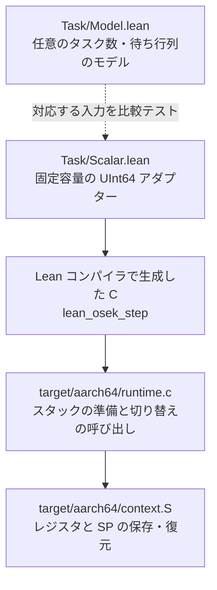

# QEMU で実際のタスク切り替えを見る

このターゲットでは、AArch64 の独立したスタックをタスクごとに確保し、
実行中のレジスタとスタックポインタを保存して、別のタスクへ切り替えます。
実行するタスクを決めるのは `LeanCpOs/Task/Scalar.lean` から生成した C です。
C のランタイムは、その決定に従って実行位置を保存・復元します。

## まず動かす

Lean はリポジトリの `lean-toolchain` に指定された版を使用します。
`lean` と `lake` を PATH に設定してください。
QEMU は Debian / Ubuntu なら `qemu-system-arm` パッケージに含まれます。

```sh
sudo apt-get update
sudo apt-get install --no-install-recommends qemu-system-arm
python3 scripts/verify_qemu.py build/qemu
```

管理者権限のないクラウド環境では、次の方法も使用できます。
APT が署名済みの配布情報とパッケージのチェックサムを検証し、
QEMU と必要なライブラリを指定ディレクトリへ展開します。
システムのパッケージやライブラリは置き換えません。
対象ホストは Debian / Ubuntu の amd64 です。

```sh
sh scripts/bootstrap_qemu.sh /workspace/qemu-tools
export QEMU_SYSTEM_AARCH64=/workspace/qemu-tools/bin/qemu-system-aarch64
python3 scripts/verify_qemu.py build/qemu
```

`/workspace/qemu-tools/bin/qemu-system-aarch64` は検証スクリプトが自動検出します。
別の場所に展開した場合は `QEMU_SYSTEM_AARCH64` に実行ファイルを指定します。
クロスコンパイルには Lean 配布物の `clang` と `ld.lld` を使います。
必要なら `LEAN_CLANG` と `LEAN_LLD` で変更できます。

すべて成功すると最後に次の行が表示されます。

```text
PASS QEMU: 7 scenarios; real task stacks; generated Lean decisions
```

実行時に QEMU を用意できない場合、検証は失敗します。
結果を保存する `qemu.json`、実際の UART 出力 `uart.log`、生成した C、
リンク済みの `osek-task.elf`、シンボル一覧とビルドログは出力先に残ります。
JSON には使用したツールの版と成果物の SHA-256 も記録されます。
全体の検証から実行する場合は、全体のレポート配下の QEMU 出力を確認してください。

## 実行の流れを読む

最初のシナリオでは、低優先度のタスク A が高優先度の B を起動します。
A は `ActivateTask(B)` の途中で中断します。B は中優先度の C を起動し、
B、C の順に終了すると、A は `ActivateTask(B)` の戻り先から再開します。

```text
TRACE preempt-resume-registers-stack: 10 20 30 11
```

| 番号 | 起きたこと |
|---|---|
| 10 | A が開始。スタック上に値を保存する |
| 20 | B が実行され、C を起動する |
| 30 | B の終了後、C が実行される |
| 11 | A が続きから再開。保存した値とレジスタが保たれていることを確かめる |

ここで A の関数を最初から呼び直すと、もう一度 10 が出てしまいます。
テストは順序に加えて、A のスタック上のローカル変数と、
AArch64 の保存対象レジスタ x19〜x29 の値を確認します。
x30 は実行位置の復帰に使われます。

同じタスクへの起動要求が複数届いた場合は、各要求を別の実行として扱います。
終了後に待っていた要求を実行するときは、関数の最初から始まります。
`TerminateTask` と `ChainTask` が成功した後の行は実行されません。
エラーの場合は状態を維持して呼び出し元へ戻ります。

## 検証する 7 つのシナリオ

| シナリオ | 確認すること |
|---|---|
| `preempt-resume-registers-stack` | 高優先度タスクによる中断と、レジスタ・ローカル変数を保った再開 |
| `equal-priority-fifo` | 同一優先度では要求順。中断されたタスクは同じ優先度の待ちタスクより先に再開する。`Schedule` は同じ優先度へ切り替えない |
| `queued-activations-fresh-entry` | 3 回の起動要求を数え、上限超過はエラー。各実行は最初から始まる |
| `chain-self-other-nonreturn` | 自分自身への連鎖、別タスクへの連鎖、成功時の非復帰、上限時のエラー復帰 |
| `nonpreemptive-explicit-schedule` | 非プリエンプティブなタスクは明示的な `Schedule` で高優先度へ譲る |
| `errors-return-with-state-intact` | 不正 ID、起動上限、呼び出し元・資源保持条件によるエラー |
| `modeled-isr-defers-dispatch` | モデル上の入れ子 ISR が終了するまで切り替えを遅らせる |

## Lean とマシンのつながり



`Scalar.lean` は 4 タスク、起動要求の総数 8、優先度 0〜15 の範囲を扱います。
優先度・起動上限・プリエンプティブかどうかは設定できます。
設定の各起動上限の合計が 8 を超える場合は、開始時にエラーにします。
配列へ収まらない要求を切り捨てることはありません。
モデル上の ISR の入れ子は 15 段までで、超過は `BADINPUT` です。
各タスクのスタックは 16 KiB、CPU は単一の Cortex-A53 です。

Lean の純粋な `UInt64` の計算だけを実行パスに含めます。
実際の Lean 配布物の `lean/lean.h` を用い、未使用のボックス化ラッパーや
モジュール初期化処理はリンカーで除去します。
検証スクリプトは、生成 C にモジュール初期化が必要な定数が追加された場合や、
ELF に未解決シンボルがある場合に失敗します。
ヒープや Lean のランタイムを起動する必要はありません。

### スカラー ABI

これはターゲット用の実験的な ABI です。OSEK の規定ヘッダーやバイナリ ABI との
互換を宣言するものではありません。実装の比較用に、ホストの
`c/task_scalar_host.c` からも同じ生成 C を呼び出します。

```c
uint64_t lean_osek_step(uint64_t config, uint64_t state,
                       uint64_t operation, uint64_t id, uint64_t context);
```

| 値 | ビット配置 |
|---|---|
| config | 0〜15: 各タスクの優先度を 4 ビットずつ。16〜31: 起動上限。32〜35: プリエンプティブ指定。36〜39: タスク数 |
| state | 0〜31: 先頭から順に 4 ビットの待ち行列。32〜35: 実行中タスク。36〜39: モデル上の ISR 深さ |
| 戻り値 | 0〜39: 次の状態。40〜43: ステータス。44〜47: 問い合わせ結果。48: 呼び出し元の継続を破棄する指定 |

タスクを格納するフィールドでは `id + 1` を使い、0 は「なし」です。
`operation` は 0: Activate、1: Terminate、2: Chain、3: Schedule、
4: GetTaskID、5: GetTaskState、7: EnterISR、8: ExitISR です。
6 は汎用モデルの進行観測用で、このアダプターでは対応しません。
`context` は 0: タスク、1: Category 2 ISR で、4 を加えると資源保持中を表します。
`status` は 0: OK、1: ID、2: LIMIT、3: CALLEVEL、4: RESOURCE、5: BADINPUT です。
問い合わせる状態の値は 1: SUSPENDED、2: READY、3: RUNNING です。
不正な config / state には、状態 0 と BADINPUT、値 0、破棄指定なしを返します。

`runtime.c` の `GetTaskID` と `GetTaskState` は、書き込み可能な正しい型の
非 NULL ポインタを呼び出し元が渡す前提です。
OSEK の未実装のエラーフックやメモリ保護を、この境界で代用していません。

## この段階の範囲

QEMU の実行は、モデル・アダプター・コンパイラ・アセンブリのつながりを確かめる
実行テストです。任意サイズのモデルと固定容量のアダプターの対応、
C 生成器、レジスタ保存コード、マシン全体の正しさについての形式証明はありません。

タスクが OS サービスを呼ぶ位置で、AAPCS64 に従って切り替えます。
すべての対象コードを `-mgeneral-regs-only` でビルドし、浮動小数点・SIMD は使用しません。
実割り込みによる任意位置の中断、割り込みコントローラー、FPU 状態、
実際の資源管理、`StartOS`、拡張タスクのイベント待ち、タイマー、マルチコアは
このターゲットの範囲外です。
ISR シナリオはソフトウェアでモデルの入退場を呼んでおり、実割り込みのテストではありません。
OSEK OS 全体の適合性やリアルタイム性を認定するものでもありません。
